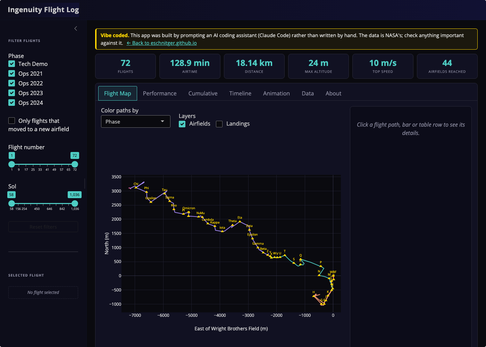

Ingenuity made the first powered, controlled flights on another planet: 72 flights in Jezero Crater between April 19, 2021 and January 18, 2024, when rotor damage ended the mission. This app follows every one of them.

**[Open the app →](https://eschnitger.github.io/ingenuity-flight-log/){target="_blank"}**

The app runs R in your browser, with no server behind it, so the first load takes 15 to 30 seconds. It works in a normal browser window, not a private one.

{target="_blank"}

::: {.callout-note}
## Vibe coded

I built this project by prompting an AI coding assistant (Claude Code) rather than writing the code by hand, and checked it by running it rather than reviewing every line. The data is NASA's; check anything important against it.
:::

## What's in it

- **Flight Map:** every flight path, colored by phase, duration, altitude or speed, with the 44 airfields. Click a flight for its details.
- **Performance:** duration, altitude, distance and speed for each flight, with records marked.
- **Cumulative and Timeline:** total airtime and distance over the mission, and when each flight happened.
- **Animation:** the flights played back one at a time.
- **Data:** the full flight table, filterable, with a CSV download.

Headline numbers: 128.9 minutes of airtime, 18.14 km flown, 24 m maximum altitude (flight 61) and 10 m/s top groundspeed (flight 62).

## Data

Flight dates, durations, altitudes, distances, top speeds, airfields and flown paths come from the Ingenuity layers behind NASA's [Where is Perseverance?](https://science.nasa.gov/mission/mars-2020-perseverance/location-map/) map, courtesy NASA/JPL-Caltech. Mission phases, average speeds and records are derived from them.

## How it's built

The app is written in R with Shiny, bslib and plotly, and compiled to WebAssembly with [shinylive](https://posit-dev.github.io/r-shinylive/) so it can be hosted on GitHub Pages. The same data also feeds Python, ggplot2 and Tableau versions of the charts.

Code: [github.com/eschnitger/ingenuity-flight-log](https://github.com/eschnitger/ingenuity-flight-log)
